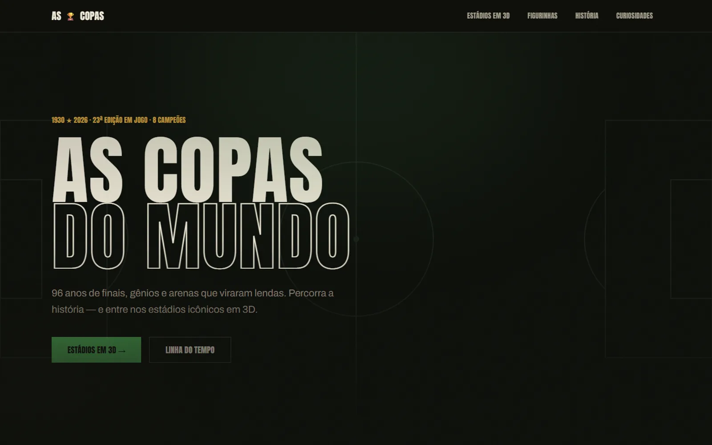
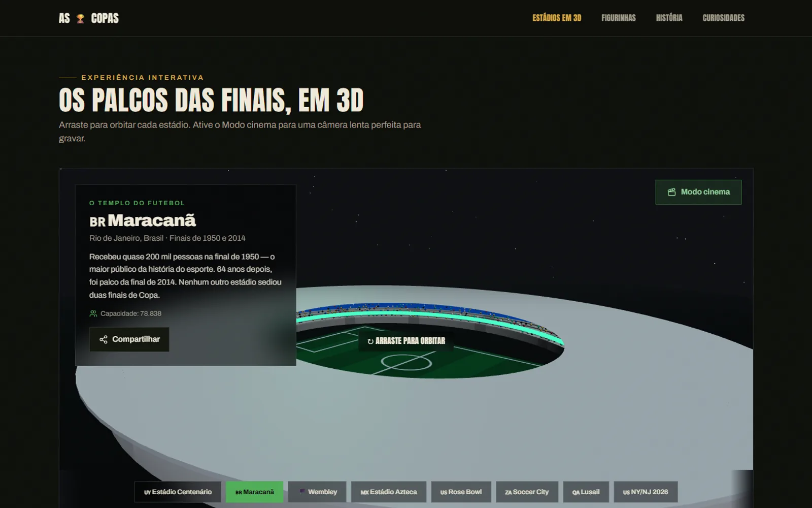

[English](README.md) | **Português**

# As Copas do Mundo (copa2026)

Site editorial sobre a história das Copas do Mundo, com estádios históricos recriados em 3D no navegador. Feito como peça de portfólio da MilWeb.

> **Tipo:** fan-made, não oficial e sem fins comerciais. Não tem vínculo, patrocínio ou endosso da FIFA, de federações ou de patrocinadores, e não usa logos nem marcas oficiais. Nomes de competições, seleções e estádios aparecem apenas com fins informativos e históricos.
> **Demo:** https://copa2026-alpha.vercel.app





## Páginas

- `/`: home com contagem regressiva da final de 2026, seção da Taça, últimas finais, vídeos e curiosidades
- `/historia`: edições de 1930 a 2022
- `/curiosidades`: curiosidades com filtro por tema
- `/estadios` e `/estadios/[slug]`: oito estádios históricos gerados em 3D (modelos procedurais, sem arquivos 3D externos), com um modo cinema para gravação de vídeo
- `/figurinhas`: álbum de figurinhas dos destaques, com links para áudios no YouTube

Todo o conteúdo é estático, em `src/data/`, acessado pela fachada `src/lib/api.ts`. As páginas são geradas no build (SSG). Também há `sitemap.xml`, `robots.txt`, imagem Open Graph gerada (`src/app/opengraph-image.tsx`) e JSON-LD.

## Stack

- Next.js 16 (App Router), React 19, TypeScript
- Tailwind CSS v4
- Framer Motion
- three, @react-three/fiber e @react-three/drei (cenas 3D, carregadas só nas páginas de estádios)
- lucide-react

## Como rodar

Pré-requisitos: Node.js 20.9+ (o CI usa Node 22) e npm.

```bash
npm ci
npm run dev     # http://localhost:3000
npm run build   # build de produção
npm run start   # serve o build
npm run lint
```

## Variáveis de ambiente

Copie `.env.example` para `.env.local` se quiser sobrescrever a URL:

- `NEXT_PUBLIC_SITE_URL` (opcional): URL canônica usada em metadata, sitemap e Open Graph. Sem ela, o código usa o endereço de produção definido em `src/lib/seo.tsx`.

## Estrutura

```
src/
  app/                 rotas (App Router), sitemap, robots, imagem OG
  components/site/     componentes de interface
  components/three/    cenas e modelos 3D dos estádios
  data/                conteúdo estático (história, curiosidades, estádios, figurinhas, mídias)
  lib/                 fachada de dados, SEO e utilitários
```

## Mídias e créditos

- Fotos: carregadas do Wikimedia Commons (`Special:FilePath`) e não hospedadas no repositório; autor e licença de cada uma estão em `src/data/media.ts`, `src/data/stickers.ts` e `src/components/site/trophy-section.tsx`, e aparecem na interface.
- Vídeos e áudios: links externos para o YouTube (miniatura estática + link, sem iframe). Os direitos pertencem aos respectivos canais.
- Modelos 3D: gerados por código (procedurais), sem arquivos de terceiros.

## Limitações

- Conteúdo estático: placares e fatos foram escritos à mão e não são atualizados automaticamente.
- `npm run lint` acusa 3 erros pré-existentes (`react-hooks/set-state-in-effect`) em `countdown.tsx` e `stadium-experience.tsx`.
- O build gera a imagem Open Graph com um emoji, que o Next baixa de `cdn.jsdelivr.net`; sem acesso a esse host o build falha nessa rota.

## Segurança

Veja [SECURITY.md](SECURITY.md).

## Licença

Ainda não há licença definida; todos os direitos reservados ao autor.
